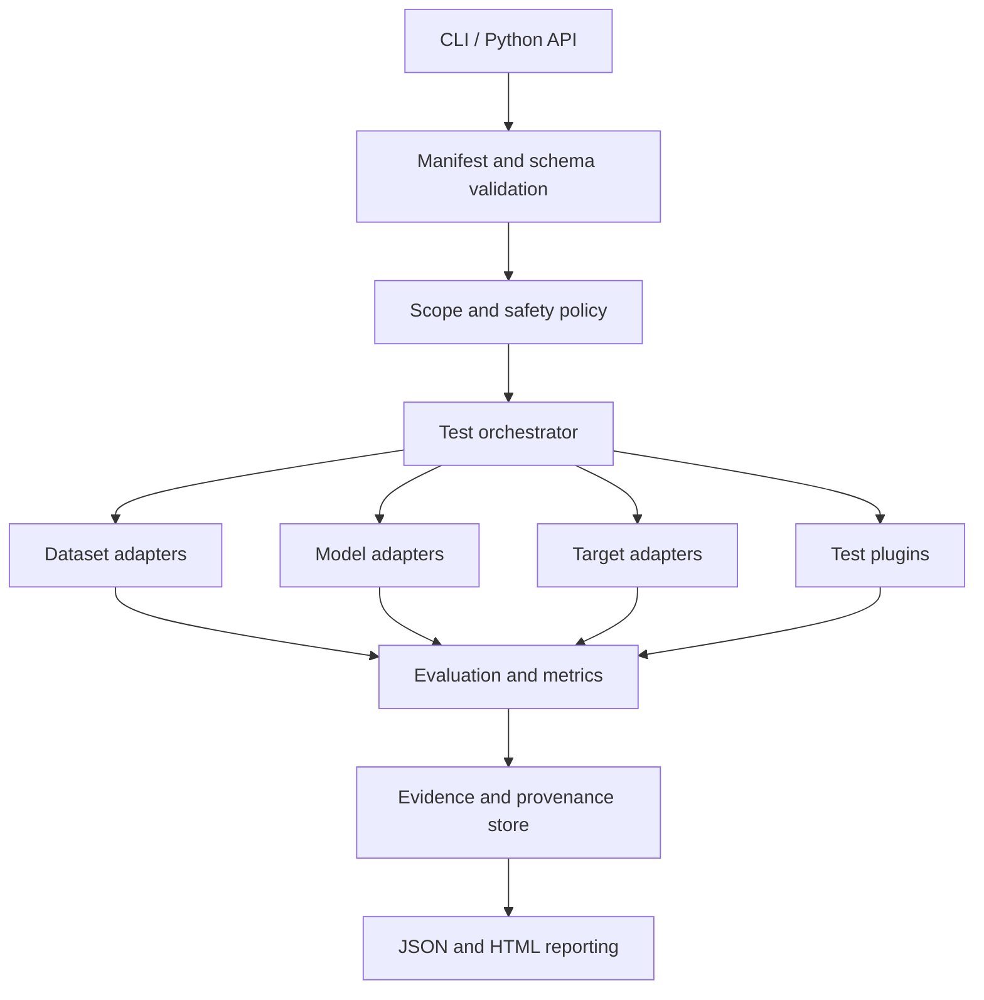

# Proposed Technical Architecture

**Status:** Draft 0.1 — Phase 0  
**Decision style:** modular monolith first; split processes only where isolation or resource management requires it.

## 1. Design goals

1. Core installation must not require PyTorch or large audio/ML dependencies.
2. Offline score evaluation must be useful before model inference or network target testing exists.
3. Model, dataset, target and test modules must have separate interfaces.
4. All results must use a versioned common envelope while retaining domain-specific metric semantics.
5. Every run must carry reproducibility metadata and explicit sample accounting.
6. The initial system should be understandable and maintainable by one developer, with an architecture that external contributors can extend later.

## 2. Logical components



## 3. Package boundaries

### Core package (no ML framework)

- CLI command registration.
- Project/run manifest schemas.
- Configuration validation.
- Test discovery and orchestration.
- Result/status schema.
- Provenance and hashes.
- Scope checks and request policy.
- Evidence index.
- JSON/HTML report rendering.
- Logging, redaction and error taxonomy.

### Optional extras

- `audio`: audio decoding, validation and transformations.
- `metrics`: numerical metrics and plotting dependencies.
- `speaker`: speaker-verification model adapters.
- `pad`: PAD model adapters.
- `http`: HTTP target adapter.
- `dev`: tests, lint, type checking and documentation.

Exact extra names and dependencies are deferred until an installation prototype and compatibility test are complete.

## 4. Interface concepts

### DatasetAdapter

Responsibilities: expose trial records, labels, split metadata, speaker/source IDs (when available), provenance and a sample accounting summary. It must not silently modify or reassign official splits.

### ModelAdapter

Responsibilities: load a declared model revision under the model trust policy, expose model metadata and preprocessing requirements, generate scores, specify score direction/class semantics, and release resources. ASV and PAD adapters are distinct capabilities even if one implementation provides both.

### TargetAdapter

Responsibilities: talk to a configured, authorized reference/target application; define test capabilities; manage test identities; capture request/response metadata; enforce timeouts and bounded requests; redact credentials. Remote adapters are disabled by default.

### TestPlugin

A test definition includes stable identifier, semantic version, category, prerequisites, permitted side effects, required capabilities, input schema, execution timeout, output schema, evidence requirements, cleanup procedure and test logic.

### MetricDefinition

A metric declares: input type, label vocabulary, positive class, score direction, threshold source, formula/version, output units, denominator policy, undefined-case behavior, confidence-interval method and references.

## 5. Result model

Each test result should have a common envelope:

```json
{
  "schema_version": "0.1",
  "run_id": "generated-id",
  "test": {"id": "ASV-METRIC-001", "version": "0.1.0"},
  "category": "speaker_verification",
  "status": "inconclusive",
  "started_at": "UTC timestamp",
  "finished_at": "UTC timestamp",
  "target_ref": "redacted-target-id-or-null",
  "dataset_ref": "dataset-id-and-version-or-null",
  "model_ref": "model-id-and-revision-or-null",
  "measurements": {},
  "sample_accounting": {"input": 0, "evaluated": 0, "excluded": 0},
  "evidence": [],
  "limitations": [],
  "error": null
}
```

This is illustrative. A formal Pydantic/JSON Schema definition will be created in Phase 1. Secrets, raw audio and direct personal identifiers do not belong in the common result envelope.

## 6. Orchestration rules

- Validate all configuration before running tests.
- Resolve dependencies and capability requirements before execution.
- Apply scope policy before creating a network connection.
- Use stable test ordering where order affects state.
- Record per-test timeouts and cleanup operations.
- Stop safely on unexpected state changes or repeated target errors.
- Distinguish test failure from runner failure.
- Persist partial results after a controlled interruption without marking unfinished tests as passed.

## 7. Storage

Initial release: filesystem-based run directories with JSON manifests and content-addressed artifact references. Use atomic writes where practical. Do not require a database or server for the first release.

Potential later storage backends must preserve portability and allow a user to delete biometric artifacts. A database is not a prerequisite for the first CLI release.

## 8. CLI concept

Proposed commands (names may change after prototype):

```text
voxrigor init
voxrigor config validate
voxrigor datasets list
voxrigor models list
voxrigor tests list
voxrigor run --profile offline-benchmark
voxrigor report <run-id> --format html
voxrigor plugins list
```

Phase 1 implements `version`, `init`, `validate`, `tests`, `run` and `report`. The initial scope is offline-only. The later commands shown above remain proposals until their corresponding phases.

## 9. Plugin trust model

Python plugins execute code. Entry-point discovery is not isolation. For the current experimental 0.1 SDK:

- load only explicitly installed/enabled plugins;
- show plugin name, version, publisher/package and declared permissions before use;
- do not auto-install dependencies;
- document that the current loader imports and executes plugins with the user's process permissions;
- require an adapter contract test suite;
- do not call the in-process loader or an ordinary subprocess a sandbox.

A platform-specific isolated-worker architecture is documented in [PLUGIN_WORKER_ISOLATION_DESIGN.md](PLUGIN_WORKER_ISOLATION_DESIGN.md). It is a design only. No worker backend, OS-enforced capability broker or resource enforcement is implemented. Do not claim isolation or permission enforcement until each platform backend passes the adversarial acceptance suite in that design.

## 10. Technology selection (provisional)

| Need | Candidate | Reason / caveat |
|---|---|---|
| Language | Python | Scientific audio/ML ecosystem and accessible contribution path. |
| CLI | Typer | Typed command interface; confirm compatibility in prototype. |
| Schema/config | Pydantic | Validation and schema generation; pin major version. |
| HTTP | HTTPX | Sync/async options, timeouts and transport control. |
| Audio arrays | NumPy/SciPy | Core numerical operations. |
| Audio file I/O | SoundFile/libsndfile | Optional audio extra; inspect decoder limitations. |
| ML | PyTorch | Optional model inference/training dependency; monitor security advisories. |
| Speaker baseline | SpeechBrain ECAPA-TDNN | Candidate speaker-verification adapter. |
| PAD baseline | AASIST | Candidate anti-spoofing adapter. |
| Test runner | pytest | Contract, unit, integration and regression tests. |
| Property tests | Hypothesis | Schema and edge-case testing. |
| Quality | Ruff + mypy | Lint/type checks; exact policy set in Phase 1. |
| Docs | MkDocs | Searchable developer documentation. |

Python support target: initially evaluate 3.11, 3.12 and 3.13 in CI. Publish only the versions that pass dependency, inference and packaging tests. Do not promise compatibility based solely on `requires-python` metadata.

## 11. Key architecture decisions to validate

- Filesystem reports before database storage.
- Score-file evaluation before mandatory model inference.
- No ML libraries in base install.
- Separate metric domains and test categories.
- Explicitly enabled plugins, no false sandbox claim.
- Local/reference targets first; remote targets later.
